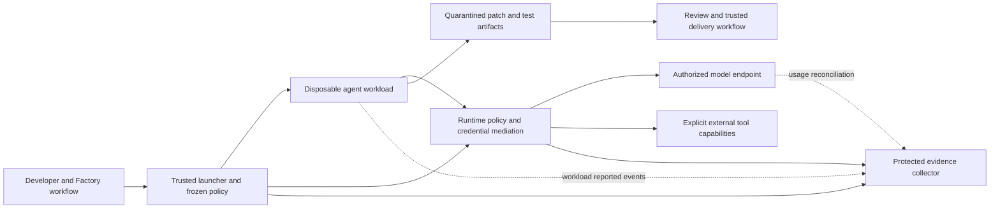

# Æion Agentic OPS: proposed framework

This is a plan, not an implemented security boundary. Requirements below are proposed Æion
requirements. Refer to the [research](../references/agentic-ops-research.md) for source-verified
upstream behavior and unresolved compatibility questions.

## Intent

Help a developer give a coding agent useful autonomy while keeping its authority explicit,
bounded, observable, and reviewable. Start with one developer, one local task, and Docker-based
execution. Keep both Claude subscription-token and OpenRouter authentication.

The framework delivers four things: a small control catalog, reference configurations for
existing runtimes, deterministic qualification checks, and operational runbooks. The public
contract is the controls and evidence, not a universal runtime abstraction.

| Project | Responsibility |
| --- | --- |
| Æion Factory | Existing development method, instructions, specs, skills, hooks and review workflow |
| Æion Agentic OPS | Execution boundaries, capability grants, lifecycle, resource limits and evidence |
| Æion CROA | Separate evidence-assessment kit for the deterministic foundation; no runtime conformance is implied |
| Æion Observability | Existing telemetry, quality and bounded-optimization specification; OPS supplies trusted execution evidence |
| Æion SpaceShip | Separate deterministic orchestration plan; owns admission/delivery decisions while OPS enforces execution scopes |

### Proposed implementation choice

Evaluate OpenShell v0.1.5 with its Docker runtime first, using versioned source and explicit
enforcement policies. It offers reusable OSS controls instead of requiring Æion to build a
network proxy or credential broker. Use Docker Sandboxes as a local comparison, and Modal as a
cloud reference. Choose a reference runtime only after the qualification results support it.

Ordinary hardened Docker remains a documented baseline for selected local repositories. It
must not be advertised as sufficient for hostile code or unrelated users. Require a separately
qualified stronger boundary, such as an appropriate VM or sandbox runtime, for those cases.

Do not build Kubernetes orchestration, a model gateway, a new container runtime, or a New Relic
replacement in the first release. Add a runtime implementation only when it solves an actual
use case and passes the same applicable controls.

## Data sources

| Source | What is read | Authority | Freshness |
| --- | --- | --- | --- |
| Operator configuration | Granted paths, destinations, actions and limits | Trusted control plane outside agent writes | Frozen per run; changes authorized and recorded |
| Factory project | Instructions, specs and selected source commit | Development context; does not grant machine permissions | Explicit revision and dirty-state handling |
| Runtime | Effective configuration, process/resource state, network decisions | Boundary evidence for controls it actually enforces | Preflight plus lifecycle events |
| Harness | Session, tool and inference events | Workload-reported, potentially incomplete or compromised | During run; detect gaps |
| Provider | Request ID, serving model/provider, returned usage and cost | Provider-reported usage, subject to reconciliation | During run and later reconciliation |
| Research register | Official sources and pinned source files | Design evidence, not execution proof | 2026-10-23; refresh before implementation |

## Inputs

The trusted launcher needs a declarative run manifest. Proposed fields are data requirements,
not an existing CLI or SDK API:

- Run and task identity; repository revision; selected authentication path and credential reference.
- Runtime, harness and image versions; image digest; effective policy digest.
- Workload-readable inputs and writable paths; artifact output rules.
- Network and external-tool capabilities, including destination, protocol, method/path where enforced.
- Wall time, idle time, CPU, memory, process, disk/output and inference limits.
- Model/provider constraints; requested supported inference parameters; fallback policy.
- Telemetry destination, content policy, retention and required audit availability.

Missing required inputs or unsupported required controls refuse launch. Unknown configuration
keys are errors. Credentials are references resolved outside the workload, not manifest values.
Repository-provided configuration is untrusted until the operator accepts it.

## Outputs

- A disposable workspace and a bounded, reviewed patch or artifact set.
- A run manifest containing resolved non-secret configuration and version identifiers.
- Qualification results: `pass`, `fail`, `unknown`, or justified `not_applicable`, per control.
- Sanitized lifecycle, policy-decision and usage records with source and quality labels.
- A final outcome and cleanup evidence, including incomplete cleanup or unresolved provider usage.

### Boundary and run flow

1. Select a source revision and stage only approved inputs. Never run repository setup on the
   host merely to prepare a sandbox. Treat package lifecycle scripts as untrusted execution.
2. Preflight the runtime, enforcement capabilities, policy, credentials, and required evidence sink.
3. Start a fresh workload. Attach only its task capabilities; keep controller credentials and
   policy storage outside its boundary. Do not mount the host checkout by default.
4. Run code and tests inside that boundary. Network-dependent setup uses a distinct, bounded
   policy; normal coding does not inherit broad installation access.
5. Stop on cancellation, deadline, resource limit, or required-control failure. Stop child
   processes and revoke mediated access; record uncertain in-flight provider requests.
6. Export bounded artifacts to quarantine. Review paths and content before importing changes.
7. Use Factory's reviewed branch/PR path for delivery. Source changes alone do not authorize a
   host execution, push, merge, deployment, migration, or production access.
8. Destroy per-task writable state and credentials/attachments. Preserve evidence under its
   retention policy; cleanup failure remains visible and blocks reuse of contaminated state.

## Invariants

Each control below needs its enforcement mechanism and test evidence attached to the release.
The IDs are proposed local IDs. They do not claim certification under an external standard.

| ID | Required behavior | Enforcement owner and decisive check |
| --- | --- | --- |
| OPS-01 | Required isolation exists; no silent downgrade | Trusted preflight; a missing kernel/runtime capability refuses launch |
| OPS-02 | Workload cannot administer the host | Runtime; no host Docker socket, privileged mode, host PID/network namespace, SSH agent, or broad device/mount access |
| OPS-03 | Writes stay in task state | Runtime filesystem policy; writes outside approved paths fail, including symlink traversal |
| OPS-04 | Network is denied unless explicitly granted | Outer network boundary; direct sockets, alternate proxies, DNS, IPv6 and metadata/LAN paths cannot bypass it |
| OPS-05 | A capability authorizes only its declared API action | Receiving service/proxy; forbidden host, port, path, method and redirected destination are denied |
| OPS-06 | Secret-isolated profiles never reveal provider secrets | External mediation; fake canary absent from workload env/files/process views/logs/artifacts and never injected at a wrong endpoint |
| OPS-07 | Credential expiry, detachment and revocation fail closed | Credential mediator; subsequent calls denied; established connections tested and terminated where necessary |
| OPS-08 | Repository text cannot expand capabilities | Protected configuration; malicious README, skill or tool response cannot edit effective policy or attach a provider |
| OPS-09 | Resource exhaustion is bounded | Runtime plus independent supervisor; CPU/memory/PID/disk/output limits and a wall-clock deadline hold |
| OPS-10 | Sessions do not inherit unrelated writable state | Runtime lifecycle; two tasks cannot read each other's workspace, memory, credentials or caches |
| OPS-11 | High-impact actions have separate authority | Trusted delivery path; coding workload has no merge/deploy/production credential; scoped action is bound to exact reviewed artifact |
| OPS-12 | Supply-chain changes cannot weaken release gates | Protected CI and trusted policy; digest/version pins, scans and changes to workflow/policy receive independent review |
| OPS-13 | Artifacts cannot turn export into host execution | Trusted exporter; traversal, symlink/hardlink/device entries and oversized output are rejected; no automatic host hooks or scripts |
| OPS-14 | Evidence distinguishes trusted and workload signals | Protected collector; workload cannot overwrite past records or impersonate the runtime; drops and outages are visible |
| OPS-15 | Usage and budgets are explicit | Provider controls and supervisor; absent usage is unknown; limits/cancellation and concurrent requests are tested |
| OPS-16 | Cleanup and incident handling work | Trusted lifecycle controller; forced termination leaves no reusable task process, attachment or writable volume |

### Authentication requirements

Both paths belong in v0's compatibility matrix. Neither becomes the mandatory product identity.

| Path | Planned configuration | Qualification needed |
| --- | --- | --- |
| Claude subscription token | Operator obtains a token through the supported Claude flow; a secret reference binds it to that user's task | Non-interactive start, recreation, conflicts, expiry, revocation, feature limitations, and proxy-side substitution |
| OpenRouter | Claude-compatible endpoint and bearer mapping; explicit model/provider constraints and key scope | Non-interactive start, streaming/tool round trip, correct billing destination, routing constraints, revocation and usage mapping |

The stock OpenShell profiles need adaptation: the Claude profile is API-key based and the
OpenRouter profile targets OpenCode. Do not assume either is already suitable for this pair.

If token substitution is incompatible with the harness, retain the token path as an explicitly
restricted local option while documenting that workload code can access the token. It cannot
pass OPS-06 or receive a credential-isolation claim. A release requiring OPS-06 must refuse that
configuration until a compatible mediation path is qualified. Do not disguise this as an
equivalent guarantee or solve it by sharing a developer's complete home directory.

### Docker implementation requirements

Use an unprivileged workload user, minimal capabilities, no new privileges, compatible syscall
filtering, resource limits and minimal mounts. Prefer a read-only root filesystem with bounded
writable areas where the harness supports it. Rootless Docker can reduce host privilege but
does not replace workload and network confinement. Check actual limits and effective policy.

Let the selected upstream runtime own the supervisor's necessary privileges. Do not break its
required seccomp or namespace operations by copying generic hardening flags blindly. Reject a
runtime whose trusted components need authority outside the accepted deployment boundary.

The allowed inference endpoint is an intentional data exit: it can receive source sent to the
model. An allowlist prevents other destinations only; it does not prove that approved endpoint
requests contain no sensitive data. Scoping a key also does not prevent misuse within its scope.

### Observability contract

Keep this as a minimal interchange contract. Reuse native OTel and runtime security events;
the Observability project owns dashboards and deeper analysis.

| Record | Minimum useful fields |
| --- | --- |
| Run | schema version, run/task/session IDs, parent run where known, source revision, policy digest, runtime/harness/image versions, start/end/outcome |
| Capability decision | timestamp, run ID, capability/control ID, allow/deny, sanitized target, policy revision, producer identity |
| Inference | logical call ID, attempt ID where observable, provider request ID, requested/observed model and serving provider, parameter provenance, latency, finish/error reason |
| Usage | native input/output/cache/reasoning counts with provider semantics, returned cost and unit, source, completeness, reconciliation state |
| Lifecycle | resource-limit/timeout/cancel reason, cleanup outcome, telemetry gaps and revocation state |

Use separate fields for harness, model publisher, router and serving provider. Requested model
aliases and a confirmed serving model are different facts. Missing effective parameters remain
null/unknown; a client setting is not evidence of server behavior. Do not invent temperature or
top-p settings for a harness that does not expose them.

Use bounded labels for metrics; put high-cardinality run/session/request IDs in logs or traces.
Do not synthesize a vendor session ID when it is absent. Use an Æion run ID for its own purpose.
Record timing and IDs without capturing hidden reasoning, prompts, source, command bodies,
tool payloads, full URLs, authentication headers or raw responses by default.

Agent telemetry is useful but can be disabled or falsified by code in the workload. Boundary
decisions must come from the trusted runtime/controller. Protect ingestion with authentication,
limits, sanitization, and source identity. A local hash chain alone is not tamper-proof storage.

### Cost and budget rules

- Preserve provider-native categories and units. Normalize only with documented mappings and
  fixtures; cache and reasoning counts may be subsets rather than additional tokens.
- Distinguish provider-returned cost, reconciled cost, local estimate and subscription allocation.
  Use decimal money arithmetic and an explicit price snapshot for estimates.
- Deduplicate usage records by the relevant provider/request/attempt identity; do not deduplicate
  separately billable retries just because the user intent is the same.
- An interrupted stream with no final usage remains incomplete; reconcile later when supported.
  Do not count every streamed cumulative frame as a new charge.
- Subscription usage has no proven per-call invoice here. Do not display invented precise dollar
  costs; any allocation of a fixed subscription is an explicitly chosen accounting estimate.
- Prefer provider/key caps where available, with time/concurrency/output limits for both paths.
  A strict pre-request budget needs reservation/reconciliation at a trusted enforcement point.
  Do not claim zero overshoot from a dashboard, an agent-side counter, or post-response telemetry.

## Determinism

The model may propose code, explain a denial, or summarize a run. It cannot grant credentials,
relax policy, validate its own isolation, set a trusted billing amount, approve a high-impact
action, or mark a failed control as passed. Those decisions belong to explicit configuration,
receiving-service authorization, runtime checks, or a human acting on a concrete artifact.

Unknown required security evidence refuses admission. Optional performance telemetry can degrade
with a visible gap; required audit loss follows the declared stop policy. Bound buffering and
timeouts so an unavailable collector cannot consume unbounded resources.

Exceptions name the control, scope, reason, owner and expiry. They are recorded outside workload
writes and shown in evidence. An exception is not a pass.

## Acceptance checks

### Cloudflare source-audit integration

The complete pinned Cloudflare security-audit-skill snapshot, including all companions, schema,
validators and tests, is retained under `vendor/`. Its
[integration runbook](../operations/cloudflare-security-audit.md) defines safe invocation, structured
finding intake, credits and an upstream check at least weekly. This adds audit guidance/tooling,
not a passing OPS control or an automatically running security audit. SpaceShip may consume its
findings only through trusted validation and scoped confidential ticketing.

### Planned implementation sequence

| Step | Concrete deliverable | Gate before the next step |
| --- | --- | --- |
| 0. Review this plan | Agree scope, control catalog, first platform and publication | Explicit approval to implement; GitHub visibility settled |
| 1. Start from Factory | Generate from the public template pinned to the recorded commit; retain license/credits and Factory method | Existing knowledge/doc/hook checks pass; no optional automation enabled incidentally |
| 2. Qualify the local boundary | One versioned OpenShell/Docker reference configuration; preflight and synthetic negative checks | OPS-01–05, 08–10 and 16 demonstrated on the declared host; limitations recorded |
| 3. Qualify both auth paths | User-scoped credential setup instructions and two minimal fixtures | Both authenticate/recreate; OPS-06/07 status explicit for each; no real secrets in tests |
| 4. Prove a real coding task | Small repository fixture with dependencies and tests, plus malicious-content fixture | Useful edits/tests succeed; boundary violations fail; artifacts export safely |
| 5. Add evidence and usage | Local bounded evidence plus optional OTLP, protocol-specific usage fixtures | OPS-14/15; retries, missing usage and costs handled honestly |
| 6. Delivery and public v0 | Protected CI, recovery runbooks and exact support matrix | Factory review gates and applicable OPS controls pass; no unsupported guarantee in README |

For Factory adoption, reuse its existing validation commands: `tools/knowledge/knowledge-check`,
`tools/knowledge/doc-links`, `tools/repo-health/repo-health`,
`python3 tools/knowledge/tests/test_doc_links.py`, and `python3 .claude/hooks/test_hooks.py`.
These prove repository conventions only; they do not prove a runtime boundary.

Proposed runtime verification must include:

1. A positive edit/build/test task under both authentication configurations.
2. Missing capability and malformed policy refusal, including `audit` versus `enforce` confusion.
3. Writes through normal paths, symlinks and protected-policy paths; attempted daemon/host access.
4. Allowed model request plus denied direct-IP, DNS, IPv6, metadata, LAN and redirected traffic.
5. Wrong API path/method and wrong-credential-endpoint rejection, with synthetic canary values.
6. Token/key expiry and revocation; already open streams and calls after detachment.
7. Bounded process spawning, memory pressure, disk/output growth, deadline and cancellation.
8. Two simultaneous tasks with no unintended workspace, cache, skill or credential sharing.
9. Malicious README/skill/MCP data requesting escalation; capability boundaries still hold.
10. A harmless fake MCP that requests a host action; denied unless an explicit scoped capability
    grants that action. Local stdio MCP must not silently inherit unrestricted host authority.
11. Traversal, symlink, executable-hook and oversized output in artifact export; host never runs it.
12. Duplicated/out-of-order usage events, cumulative streaming chunks, truncated streams, retries,
    fallback provider changes, missing fields, and subscription cost without a per-call invoice.
13. Collector outage, event floods, forged workload identity, redaction, retention and cleanup.
14. A modified security/CI configuration that cannot approve or release itself.

Run synthetic tests with bounded fixtures, fake credentials and local endpoints first. Live
authentication is an operator step using an existing credential reference; never ask an agent to
read or print the credential. Real provider calls need an explicit bounded test budget.

Every qualification report records commit, policy/image digests, runtime/harness/platform
versions, checks executed, results, skips and limitations. `unknown` and skipped checks cannot
satisfy required release controls. The support matrix is per runtime, platform and auth path.

### Proposed repository additions after approval

Keep Factory's layout. Add the component spec and source register, `infra/` for reviewed runtime
configuration, and targeted tools/tests for preflight and qualification. Add files when their
slice needs them; avoid an empty adapter hierarchy or service skeleton.

Runbooks must cover credential setup/rotation, policy exceptions, failed admission, cancellation,
cleanup failure, suspected exfiltration, dependency/image updates and safe artifact recovery.
On an incident: stop the workload and its egress, revoke affected access, preserve sanitized
external evidence, quarantine outputs, and rebuild from known inputs before resuming.

## Out of scope

- Changing Factory's core method, implementing CROA, or assuming what its acronym means.
- Production operations, automatic deployment, or trading authority.
- A hosted multi-user service, shared subscription credentials, Kubernetes or a new control plane.
- A new inference protocol converter or proxy where an existing tested integration suffices.
- Building the future Observability user interface or comparing models using lines of code.
- Claims of perfect security, universal model compatibility, reproducible model output, regulatory
  certification, or complete visibility into private model reasoning.
